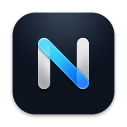

<p align="center">
  
</p>

<h1 align="center">NexBar</h1>

<p align="center">
  轻量级原生 macOS 状态栏助手 —— 实时监控 CPU、上下行网速与磁盘空间，并内置安全的 Xcode / Flutter 构建缓存清理工具。
</p>

---

## 核心特性

- **紧凑状态栏常驻**
  - 纯菜单栏模式运行（`LSUIElement = YES`，不占用 Dock 空间），支持登录自启（`SMAppService`）。
  - 实时显示 CPU 百分比与双行等宽左对齐上下行网速（最小单位 `K/s`，固定列宽不抖动，固定每 2 秒刷新）。
  - 可在设置中独立开关状态栏 CPU 或网速显示。
- **监控详情面板**
  - **CPU 负载**：总占比、用户/系统/空闲构成、实时折线图以及逻辑多核负载柱状条（基于 Mach `host_processor_info`）。
  - **网络流量**：实时上传/下载速度、双曲线趋势、活跃物理网卡标识与本次会话累计流量（基于 BSD `sysctl NET_RT_IFLIST2` 64 位计数，自动排除 VPN/AirDrop 虚拟接口防止双倍统计）。
  - **系统磁盘**：直观展示系统卷已用/可用空间，一键跳转缓存清理。
- **安全构建缓存清理**
  - 内置 **Xcode DerivedData**（`~/Library/Developer/Xcode/DerivedData`）与 **Flutter 项目缓存**（递归扫描 `~/projects`，自动识别声明 `sdk: flutter` 的 `pubspec.yaml`，定位 `.dart_tool` 与 `build`）。
  - 完整安全护栏（扫描标注 + 删除前二次复检）：自动跳过 `.git` / `.gradle` / `.next` / `.venv` / `node_modules` / `Pods` 与软链接目录，校验常规目录/非软链/非挂载点，并通过 `git ls-files` 自动保护包含 Git 已跟踪文件的目录。
  - 先扫描预览体积与路径、支持勾选与访达定位、永久删除前提供二次确认。

---

## 运行环境

- **系统要求**：macOS 14.0 及以上（Apple Silicon）
- **分发方式**：本项目不上架 Mac App Store，直接通过 GitHub Releases 分发 `.dmg` 安装包（关闭 App Sandbox 以直接扫描构建缓存与执行 `git` 校验）。

---

## 安装方式

1. 前往仓库的 **Releases** 页面下载最新版本的 `NexBar-<version>-arm64.dmg`。
2. 双击打开 DMG，将 `NexBar.app` 拖入 `Applications`（应用程序）文件夹。
3. 由于安装包采用 Ad-hoc 签名（未经过 Apple 公证），首次打开若遇到 macOS 提示“无法验证开发者”或“已损坏”，请任选以下一种方式放行：
   - **终端一键放行（推荐）**：
     ```bash
     xattr -cr /Applications/NexBar.app
     ```
   - 或前往 **系统设置 → 隐私与安全性**，在底部点击 **仍要打开**。

---

## GitHub Actions 自动打包与发布 DMG

仓库已内置两个工作流（运行在 `xcode-27` Apple Silicon Runner）：

- **持续集成**：[`.github/workflows/ci.yml`](.github/workflows/ci.yml)
  - 推送或提交 PR 到 `main` 时自动运行核心单元测试并校验 Release 编译。
- **打包并发布 DMG**：[`.github/workflows/release.yml`](.github/workflows/release.yml)
  - **方式一（推荐）：推送版本标签自动发版**
    ```bash
    git tag v1.0.0
    git push origin v1.0.0
    ```
    Actions 将自动执行单元测试 → Release 编译 → Ad-hoc 签名 → 打包 `NexBar-1.0.0-arm64.dmg` 与 `.sha256` 校验文件 → 自动创建对应的 GitHub Release 并上传附件。
  - **方式二：手动触发打包**
    - 在 GitHub 仓库的 **Actions → Release DMG → Run workflow** 中手动运行，可在 Artifacts 中直接下载生成的 `.dmg`（勾选 `publish_release` 可同时发布 Release）。

---

## 本地开发与打包

### 1. 使用 Xcode 运行
直接打开 `NexBar.xcodeproj`，选择 `NexBar` scheme 按 `⌘R` 运行。

### 2. 运行核心单元测试
```bash
swiftc -parse-as-library -target arm64-apple-macosx14.0 \
  NexBar/Models/SystemMetrics.swift \
  NexBar/Models/CleanupModels.swift \
  NexBar/Services/ByteRateFormatter.swift \
  NexBar/Services/CPUSampler.swift \
  NexBar/Services/NetworkSampler.swift \
  NexBar/Services/DiskCleanerEngine.swift \
  Tests/NexBarCoreTests.swift \
  -o /tmp/NexBarCoreTests && /tmp/NexBarCoreTests && rm -f /tmp/NexBarCoreTests
```

### 3. 本地一键打包 DMG
```bash
./scripts/package-dmg.sh --version 1.0.0
```
产物输出至 `dist/NexBar-1.0.0-arm64.dmg` 与 `dist/NexBar-1.0.0-arm64.dmg.sha256`。

---

## 目录结构

```text
NexBar/
├── App/                  # AppDelegate（状态栏与 Popover 生命周期）
├── Models/               # 指标数据模型、清理模型与持久化设置
├── Services/             # CPU/网速/磁盘采样器、格式化器与缓存清理引擎
├── Views/
│   ├── StatusBar/        # 菜单栏紧凑视图（NSView）
│   ├── Popover/          # 监控 / 清理 / 设置三栏 SwiftUI 界面
│   └── Components/       # Canvas 实时折线图组件
└── Assets.xcassets/      # AppIcon 与 BrandLogo 图标资源
Tests/                    # 核心逻辑单元测试（格式化、采样、清理引擎与 Git 安全护栏）
scripts/                  # 本地与 CI 共用的 DMG 打包脚本
.github/workflows/        # GitHub Actions CI 与 DMG 自动发布工作流
```
